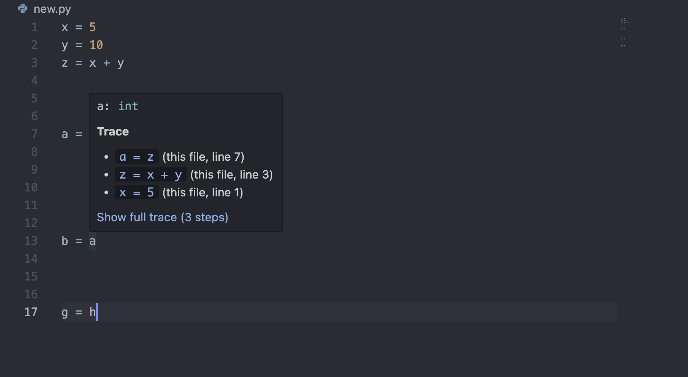
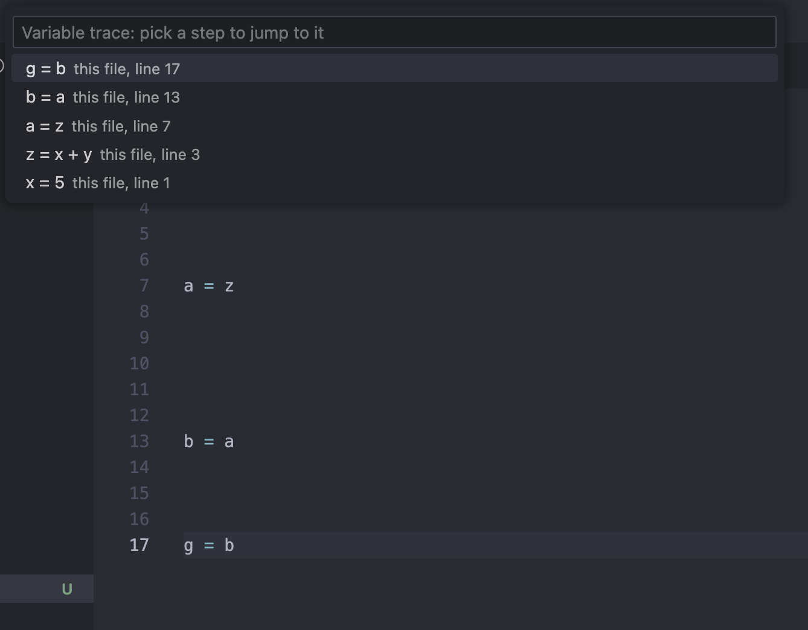
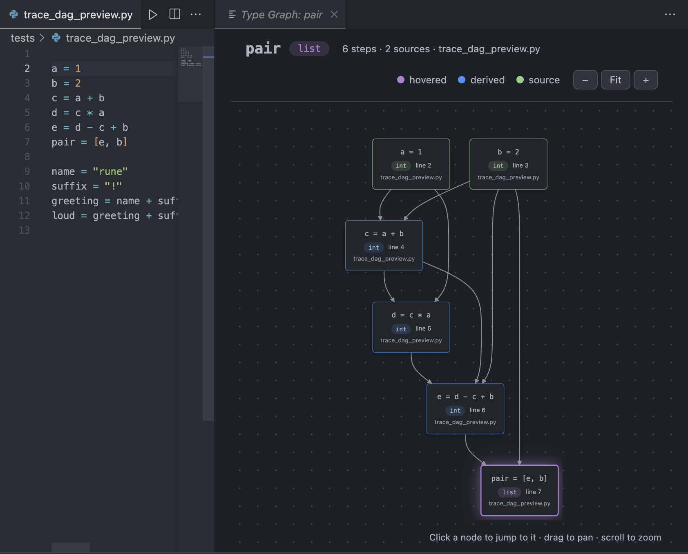
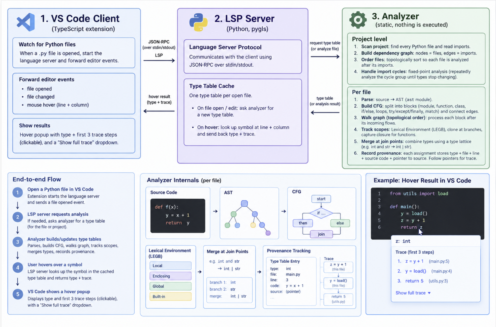
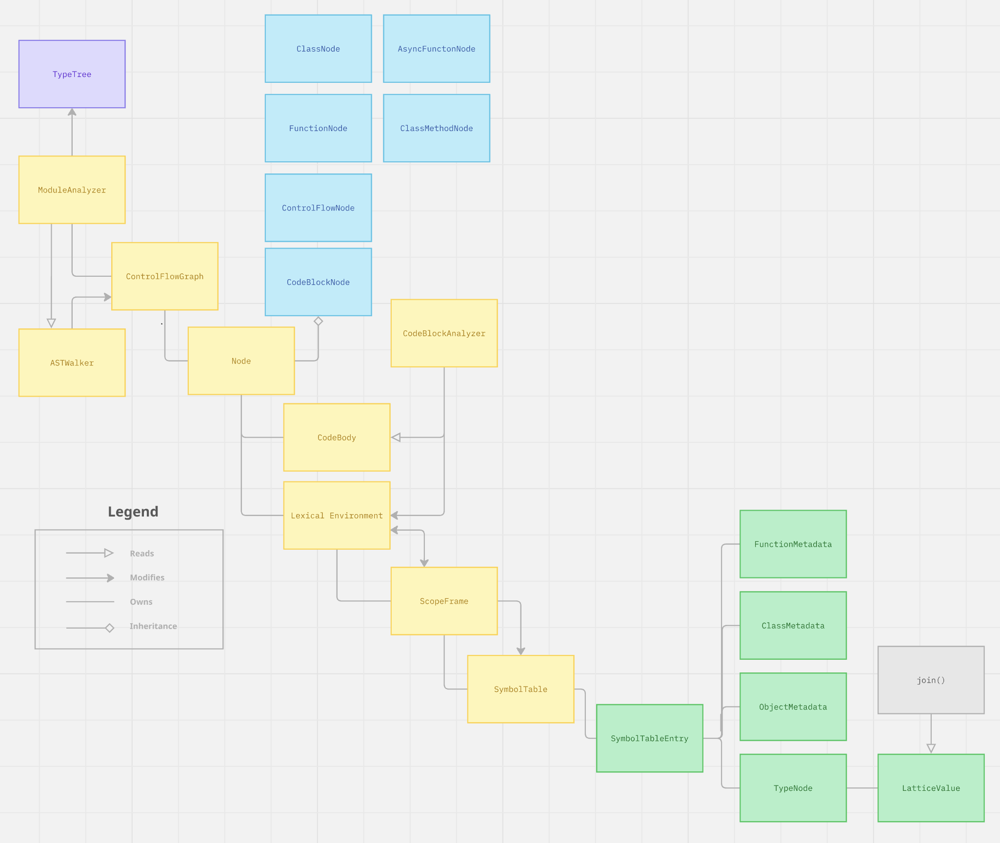
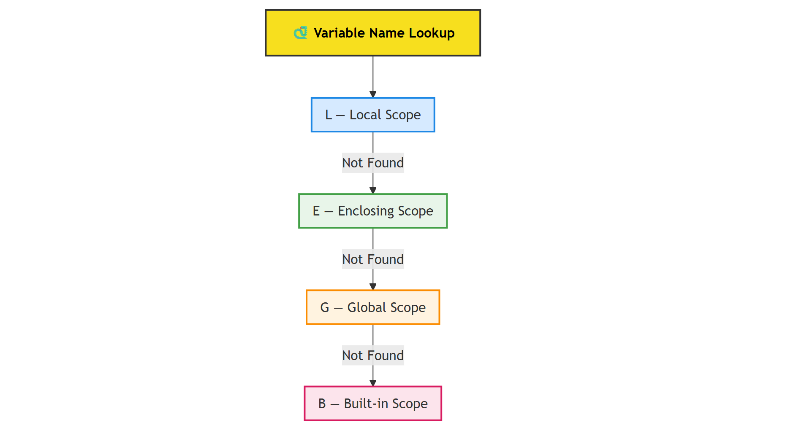
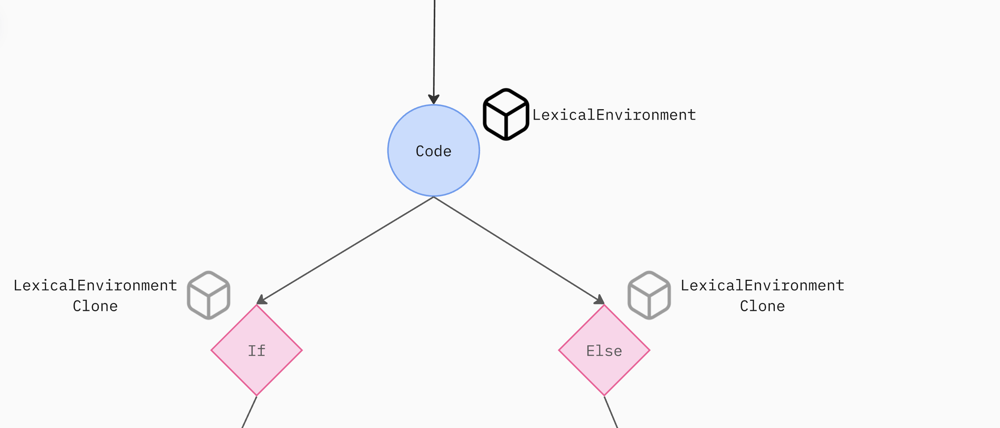
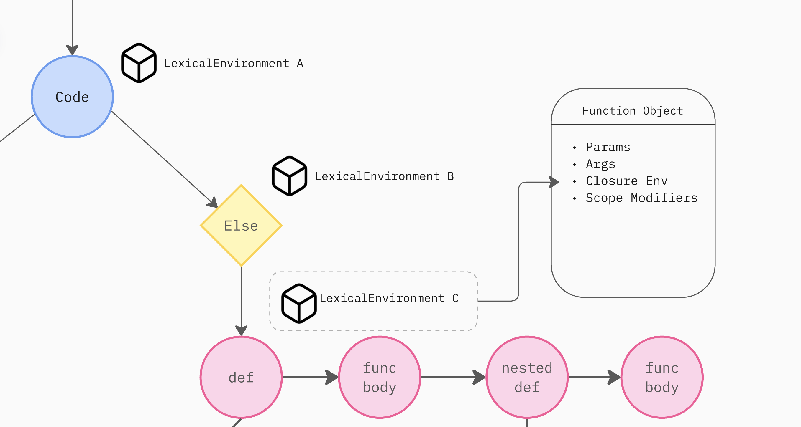

### Branch Descriptions

- Backup: A secondary copy of master
- Master: Source of truth, merged development into master
- Development: The branch where work is actually being done
- Main: The one for showing on the repo
- Experimental: The one that uses heavy AI.


<h1 align="center">Rune: A Type Analzyer for Python</h1>
<p align="center"></p>
<p align="center"><sub>Image credit: <a href="https://lbbonline.com/news/It-Feels-Good-to-GEICO">GEICO, via LBB Online</a></sub></p>

### What's This About
Python's dynamic typing makes it hard to tell what type a variable is in a large codebase (like LangChain, SQLAlchemy, PyTorch), and even harder to tell *where that type came from*.

```python
def get_profile(session, user_id):
    result = session.query(User).filter_by(id=user_id).first() # What is the type of result?? 
```

Rune began as a modest attempt to build a type checker of sorts. It remains a work in progress, but my hope is that it offers Python developers meaningful quality-of-life improvements in their day-to-day work.

## Rune's Features

Rune is a VScode extension that runs as a language server to provide real time type analysis of your Python code.

**You can view types on hover, and see their assignment trace.** 

<h4 align="center">Showing the type information and trace </h4>
<p align="center"></p>

**Left clicking on "Show Full Trace" shows every line. Clicking on a line jumps to file and line.** 

<h4 align="center"> Opening a full trace window with jump-to-file-line function </h4>
<p align="center"></p>

**"View as graph" generates a graph that shows the history of a variable and the flow of sources from different files to give a variable get its value** 

<h4 align="center"> Rune's Type Graph </h4>
<p align="center"></p>

This lets you manually inspect each node, and clicking on it jumps to that file and line for manual inspection.

Rune implements on its own typing engine, and does not rely on any other existing software (MyPy, Pyright etc) to provide type information.


## Project Architecture

<p align="center"><em>The project's architecture (Generated with AI from project brief & codebase) </em></p>
<p align="center"></p>

The checker's architecture runs on three separate logical components. 

- A editor side client which emits events like file open, hover, file change. 
- An LSP server which captures changes over JSON-RPC, and transmits info to the analyzer
- A analysis engine that performs the type checking on the codebase

While the editor client and LSP are minimally implemented, the roadmap analyzer is not yet done, and is a WIP.

## Technical Details 

### How does type checking work

Type checking is a static analysis problem. We'd have to essentially construct a lexical understanding of a program to understand its contents before 
we can even begin typing. This entails procedures similar what compilers do to languages like C++/Go/Rust to turn it into machine code.

As mentioned from the project diagram, for a single file we'd have to first token a the program's lexemmes and parse it into an abstract syntax tree, then derive a control flow graph and perform data flow analysis over it. 

Step by Step: 
- Regex over a program to tokenize it
- Parsing (stack machine/LR(1)/LALR(1)) with CFG rules (for Python) to create an AST
- Descending the AST to create a CFG
- Walking the CFG in topological order
- Perform data flow analysis while maining lexical scoping rules
- Merging type information from two branches of reality (i.g a branch)
- Storing provenance information

The following is a WIP stack diagram of the objects that handle a single file's typing:

### Single File Analysis

<p align="center"></p>
<p align="center"><em>Module dependency and API graph</em></p>

The main controller, `ModuleAnalyzer`, oversees generation of the control flow graph via the `ASTWalker` class. It owns the graph traversal logic; a topological sort over the CFG; and calls `CodeBlockAnalyzer` on each graph node (a chunk of program text) to process and persist type information into a symbol table.

### Store and LEGB

A `LexicalEnvironment` object stores a stack of symbol tables. The stack naturally models Python's [LEGB semantics](https://realpython.com/python-scope-legb-rule/).

<p align="center"></p>

Say we're processing `x: int = 5` and want to know which `x` we're actually referring to. We'd:

1. Look up the `local` scope — the topmost symbol table on the stack
2. Look up `enclosures` — the middle symbol tables
3. Fall back to the `global` table — the lowest table on the stack

...and finally the built-ins, which every Python program gets for free.

As execution moves into and out of function calls, the stack pops and pushes frames, naturally modelling the environment as it changes.

### Environment Capturing

Storing a `LexicalEnvironment` per graph node — a 1:1 mapping between node and environment — gives us some nice properties for free. Branching, for one: the environment is simply *cloned* for each child branch.

<p align="center"></p>
<p align="center"><em>Environment cloning on branching</em></p>

It also makes capturing a [closure environment](https://realpython.com/python-closure/) for a function straightforward — just note the `LexicalEnvironment` instance at the entrypoint of a function definition's subgraph.

<p align="center"></p>
<p align="center"><em>Capturing a closure environment</em></p>

Where branches converge back together (an `if`/`else` rejoining, a `try`/`except`/`finally` funnelling into one path), the environments are joined rather than picked arbitrarily — each variable's type becomes the least upper bound of what it could be across the branches that fed into that point, via a small type lattice (`LatticeValue.join`).

### Writing to an Output

The output streams into an output data structure. Ideally this happens asynchronously, so upstream engines and project-level controllers can surface type information as soon as it's ready.

*But what if a symbol's type information isn't complete when first published?*

Because the graph analysis runs topologically, every section of a program with a bearing on the type of a variable `x` — the "flow" into `x` — is guaranteed to be processed before `x` itself is. So by the time we process a given node, we already have every piece of prerequisite knowledge we need to analyze it correctly.

## Status

This project is a work in progress. 
